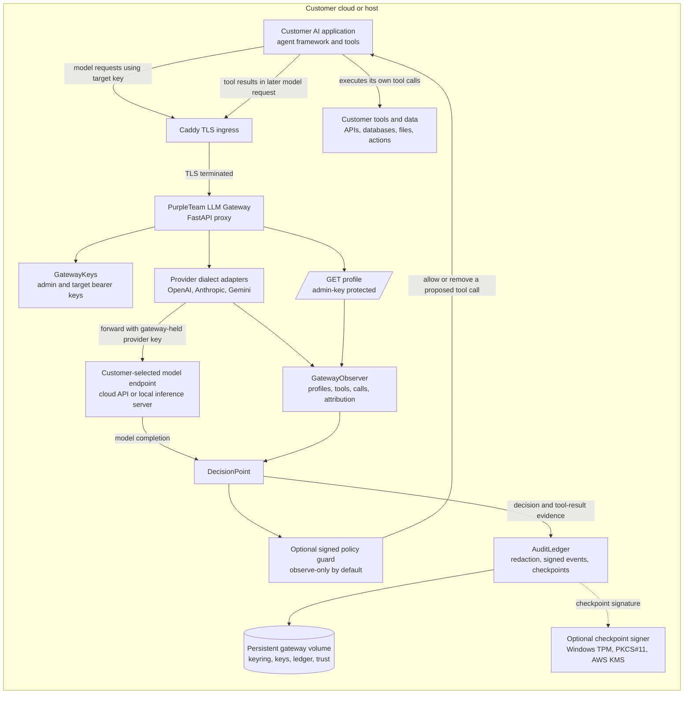
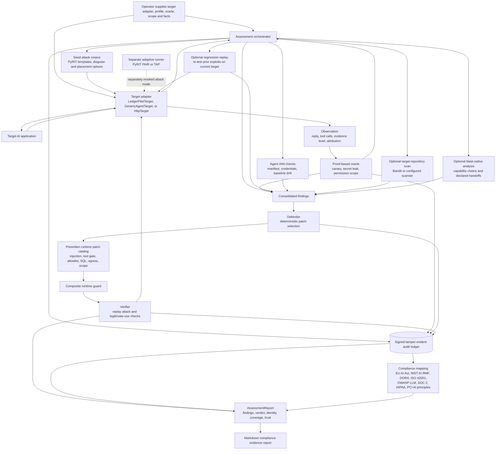
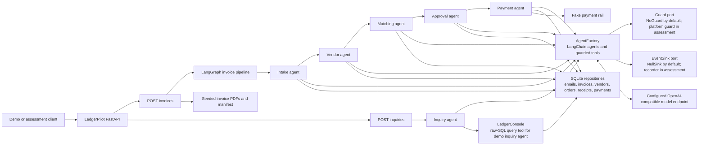
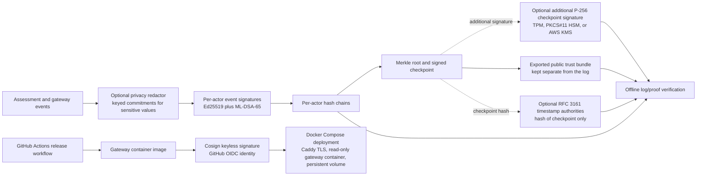
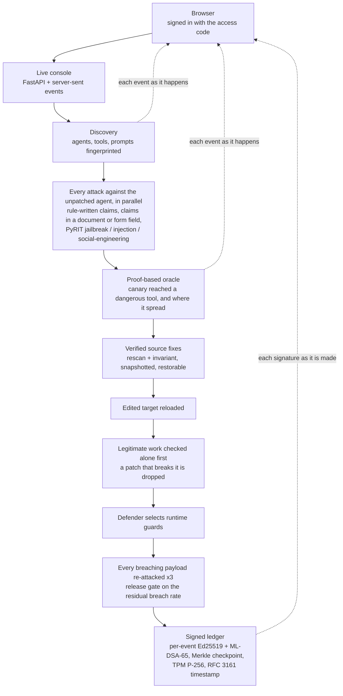

# PurpleTeam system architecture

This describes the current repository implementation. It separates the deployable LLM gateway, the Python assessment engine, the live console that drives it, the LedgerPilot demo target, and release/audit trust. The gateway Compose stack is deployable on its own; the assessment engine runs from the live console (section 5), from `purpleteam.assess` for another agent repository, or directly from Python.

## 1. Customer deployment and model traffic

The gateway observes model requests and responses, including declared tools and model-proposed tool calls. It does not execute customer tools; the customer agent does. With a verified signed policy enabled, the gateway can withhold model-proposed calls before the agent receives them. Provider-executed native tools run upstream and cannot be stopped by the gateway, so enforcement rejects them by default.

## 2. Purple Team assessment and remediation loop

`Assessment.run` with no templates uses the seed corpus; the live console passes its own model-free set instead (section 5). PAIR/TAP is a separately callable adaptive attack runner, not automatically invoked by the default `Assessment.run`. Static repository scanning, baseline comparison, regression replay, blast-radius analysis, disguises, and placement variants are optional inputs or modes. The oracle—not the adaptive scorer—decides whether evidence proves a breach. A selected runtime guard is attached through the target adapter and then verified by replaying attacks and legitimate requests.

## 3. LedgerPilot demonstration target

LedgerPilot is intentionally vulnerable and exists as a realistic demo target, not as part of the customer platform. Its `Guard` and `EventSink` ports let the assessment adapter attach runtime protection and capture tool activity without making LedgerPilot import the platform.

## 4. Evidence, hardware signing, timestamping, and release trust

The TPM/HSM/KMS key adds a signature to checkpoints; it does not attest the host, prove the container is unmodified, or sign every event. The gateway image’s Cosign signature is a separate release-integrity mechanism. Timestamp anchoring is optional and proves a checkpoint existed by the timestamp, not that the contents are truthful.

## 5. Live console: one run, end to end

`purpleteam.live_run` composes the run; `purpleteam.live_demo` serves it behind `purpleteam.demo_auth`. In the default (`PURPLETEAM_ONLY_STATIC`) the attacker uses no model; the defender's model only drafts source fixes. Each signed event is pushed to the page and verified against its signer's public key before the run is sealed; the checkpoint at the end signs the Merkle root of them all.

## Current boundaries

- The Compose deployment packages the gateway and Caddy. The live console is a single-operator tool behind one access code (`deploy/azure_windows.ps1` hosts it); the multi-user fleet console watches gateways, not assessments.
- External HTTP targets use `HttpTarget`; framework-neutral model observation depends on traffic routed through the gateway. The current repository does not include a packaged remote assessment client that automatically coordinates a separately deployed gateway’s `/profile` endpoint with the assessment runner.
- The current provider dialects are OpenAI-compatible, Anthropic, and Gemini. There is no dedicated RAG/vector-database or MCP security subsystem in this repository.
- The defender selects prewritten runtime guards. Verified source codemods are applied to the configured target repository (catalog-approved, or model-drafted and auto-approved only when the rescan and the independent invariant both pass, labelled as not human-reviewed); every original is snapshotted and one restore reverts them all.
- The Windows TPM implementation signs ledger checkpoints. It is not TPM remote attestation. On an Azure Trusted Launch VM the TPM is virtual (protected by Azure's host). The hardware detector notes that WSL2 does not expose the host TPM to the Linux environment.
